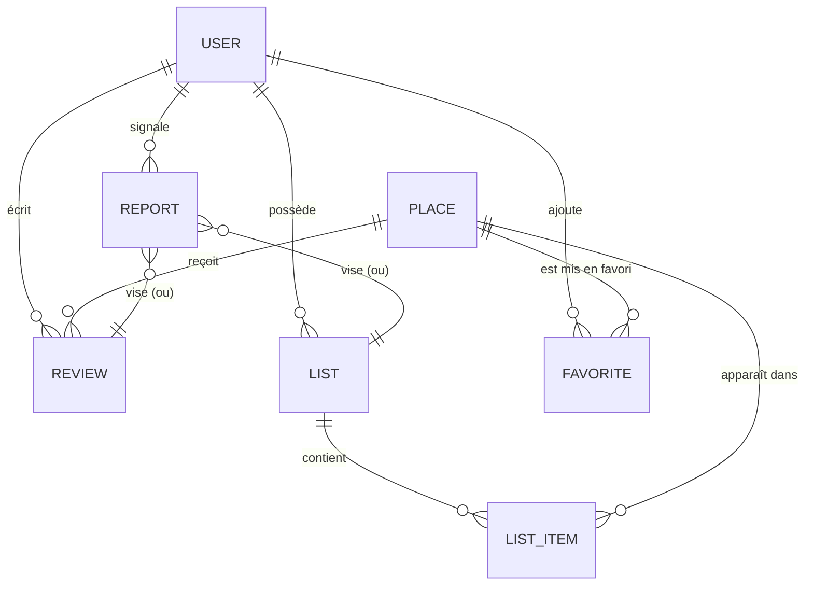

# Activité – Designer une API : spécification de l'API CityAddict

## Contexte

**CityAddict** permet de **découvrir, rechercher et noter des lieux de sortie** : restaurants, bars et cafés.

- L'utilisateur peut créer des **listes de lieux**, publiques ou privées, et gérer ses **favoris**.
- Les administrateurs peuvent **gérer les lieux** et **modérer les contenus**.

**Objectif :** rédiger le document de spécification de l'API.

1. Identifier les **ressources** et leurs relations.
2. Définir les **points d'entrée**, leurs méthodes et leurs paramètres.
3. Concevoir les **structures de données entrantes**.
4. Concevoir les **structures de réponses**.

---

## 0. Conventions générales

| Sujet | Choix |
|---|---|
| URL de base | `https://api.cityaddict.fr/v1`. La version est dans l'URL, ce qui permet de faire évoluer l'API sans casser les clients. |
| Format | JSON uniquement (`Content-Type: application/json`) |
| Langue du nommage | **anglais** pour les ressources et les champs (une seule langue) |
| Casse | URL en minuscules et au **pluriel** (`/places`), champs en **snake_case** (`created_at`) |
| Identifiants | entiers (`id`) |
| Dates | ISO 8601 en UTC : `"2026-11-23T14:30:00Z"` |
| Authentification | jeton JWT dans le header `Authorization: Bearer <token>` |
| Pagination | paramètres `page` (défaut 1) et `limit` (défaut 20, max 100) |
| Tri | paramètre `sort`, avec `-` devant pour l'ordre décroissant : `sort=-rating` |
| Réponses | une **enveloppe uniforme** : `data` + `meta` pour une collection, `error` pour une erreur (voir partie 4) |

### Les acteurs

| Acteur | Description |
|---|---|
| **Visiteur** | non connecté : peut découvrir, rechercher et lire |
| **Utilisateur** (`user`) | connecté : note, crée des listes, gère ses favoris, signale un contenu |
| **Propriétaire** | l'utilisateur qui a créé l'avis ou la liste concernée (ce n'est pas un rôle, c'est une condition) |
| **Administrateur** (`admin`) | gère les lieux et modère les avis, les listes et les utilisateurs |

---

## 1. Les ressources et leurs relations

### Les ressources

| Ressource | Description | Principaux champs |
|---|---|---|
| **User** | un compte | `id`, `username`, `email`, `password` (haché, jamais renvoyé), `role` (`user`, `admin`), `avatar_url`, `status` (`active`, `banned`), `created_at` |
| **Place** | un lieu de sortie | `id`, `name`, `type` (`restaurant`, `bar`, `cafe`), `description`, `address`, `location` (lat/lng), `phone`, `website`, `price_level` (1 à 4), `opening_hours`, `status` (`published`, `hidden`), `average_rating`, `reviews_count`, `created_at`, `updated_at` |
| **Review** | la note et l'avis d'un utilisateur sur un lieu | `id`, `place_id`, `user_id`, `rating` (1 à 5), `comment`, `status` (`visible`, `hidden`), `created_at`, `updated_at` |
| **List** | une liste de lieux créée par un utilisateur | `id`, `owner_id`, `name`, `description`, `visibility` (`public`, `private`), `status` (`visible`, `hidden`), `places_count`, `created_at`, `updated_at` |
| **ListItem** | un lieu dans une liste (table de liaison) | `list_id`, `place_id`, `note` (commentaire perso), `added_at` |
| **Favorite** | un lieu mis en favori (table de liaison) | `user_id`, `place_id`, `created_at` |
| **Report** | un signalement d'un contenu à modérer | `id`, `reporter_id`, `target_type` (`review`, `list`), `target_id`, `reason`, `status` (`pending`, `accepted`, `rejected`), `handled_by`, `created_at`, `handled_at` |

`average_rating`, `reviews_count` et `places_count` sont des **champs calculés** : l'API les renvoie, mais on ne peut pas les envoyer.

### Les relations

| Relation | Cardinalité |
|---|---|
| User → Review | un utilisateur écrit **0..n** avis |
| Place → Review | un lieu reçoit **0..n** avis |
| User + Place → Review | **un seul avis par utilisateur et par lieu** (règle métier) |
| User → List | un utilisateur possède **0..n** listes |
| List ↔ Place | **n..n** via `ListItem`, et un lieu n'apparaît qu'une fois par liste |
| User ↔ Place (favoris) | **n..n** via `Favorite` |
| User → Report | un utilisateur fait **0..n** signalements |
| Report → Review / List | un signalement vise **un** avis ou **une** liste |



---

## 2. Les points d'entrée

**Légende des accès :**
- 🌐 public (visiteur)
- 👤 utilisateur connecté
- ✍️ propriétaire de la ressource
- 🛡️ administrateur

### 2.1 Authentification et compte

| Méthode | URI | Description | Accès | Succès |
|---|---|---|---|---|
| `POST` | `/auth/register` | Créer un compte | 🌐 | **201** |
| `POST` | `/auth/login` | Se connecter, renvoie un jeton | 🌐 | **200** |
| `GET` | `/users/me` | Voir mon profil | 👤 | **200** |
| `PATCH` | `/users/me` | Modifier mon profil | 👤 | **200** |
| `DELETE` | `/users/me` | Supprimer mon compte | 👤 | **204** |
| `GET` | `/users/{id}` | Profil public d'un utilisateur (pseudo, avatar) | 🌐 | **200** |
| `GET` | `/users/{id}/lists` | Listes **publiques** d'un utilisateur | 🌐 | **200** |

### 2.2 Lieux (découvrir, rechercher, gérer)

| Méthode | URI | Description | Accès | Succès |
|---|---|---|---|---|
| `GET` | `/places` | Rechercher et lister les lieux | 🌐 | **200** |
| `GET` | `/places/{id}` | Détail d'un lieu | 🌐 | **200** |
| `POST` | `/places` | Ajouter un lieu | 🛡️ | **201** |
| `PUT` | `/places/{id}` | Remplacer un lieu | 🛡️ | **200** |
| `PATCH` | `/places/{id}` | Modifier un lieu (dont le masquer : `status: hidden`) | 🛡️ | **200** |
| `DELETE` | `/places/{id}` | Supprimer un lieu | 🛡️ | **204** |

**Paramètres de recherche de `GET /places`** (query string, tous facultatifs) :

| Paramètre | Type | Exemple | Effet |
|---|---|---|---|
| `q` | texte | `q=pizza` | recherche dans le nom et la description |
| `type` | `restaurant` \| `bar` \| `cafe` | `type=bar` | filtre par type ; plusieurs valeurs possibles : `type=bar,cafe` |
| `city` | texte | `city=Paris` | filtre par ville |
| `price_level` | entier 1–4 | `price_level=2` | filtre par gamme de prix |
| `min_rating` | nombre 0–5 | `min_rating=4` | note moyenne minimale |
| `lat`, `lng`, `radius` | nombres (radius en mètres, max 50 000) | `lat=48.85&lng=2.35&radius=1000` | lieux autour d'un point (les 3 vont ensemble) |
| `sort` | `name`, `rating`, `-rating`, `-created_at`, `distance` | `sort=-rating` | ordre des résultats (`distance` seulement avec `lat`/`lng`) |
| `page`, `limit` | entiers | `page=2&limit=20` | pagination |

Exemple : `GET /places?type=bar&city=Paris&min_rating=4&sort=-rating&page=1&limit=20`

Les lieux `hidden` n'apparaissent que pour un administrateur.

### 2.3 Avis et notes

| Méthode | URI | Description | Accès | Succès |
|---|---|---|---|---|
| `GET` | `/places/{id}/reviews` | Avis d'un lieu (`sort=-created_at` ou `-rating`, `page`, `limit`) | 🌐 | **200** |
| `POST` | `/places/{id}/reviews` | Noter un lieu (un seul avis par lieu) | 👤 | **201** |
| `GET` | `/reviews/{id}` | Détail d'un avis | 🌐 | **200** |
| `PATCH` | `/reviews/{id}` | Modifier mon avis | ✍️ | **200** |
| `DELETE` | `/reviews/{id}` | Supprimer un avis | ✍️ 🛡️ | **204** |
| `GET` | `/users/me/reviews` | Mes avis | 👤 | **200** |

### 2.4 Favoris

| Méthode | URI | Description | Accès | Succès |
|---|---|---|---|---|
| `GET` | `/users/me/favorites` | Mes lieux favoris (`page`, `limit`) | 👤 | **200** |
| `PUT` | `/users/me/favorites/{placeId}` | Ajouter un lieu en favori | 👤 | **204** |
| `DELETE` | `/users/me/favorites/{placeId}` | Retirer un favori | 👤 | **204** |

`PUT` est **idempotent** : ajouter deux fois le même favori ne crée pas de doublon et ne provoque pas d'erreur. Le lieu est identifié dans l'URL, il n'y a donc pas de corps de requête.

### 2.5 Listes de lieux

| Méthode | URI | Description | Accès | Succès |
|---|---|---|---|---|
| `GET` | `/lists` | Parcourir les listes **publiques** (`q`, `page`, `limit`, `sort`) | 🌐 | **200** |
| `GET` | `/users/me/lists` | Mes listes, publiques **et** privées | 👤 | **200** |
| `POST` | `/lists` | Créer une liste | 👤 | **201** |
| `GET` | `/lists/{id}` | Détail d'une liste (publique, ou privée si c'est la mienne) | 🌐 ✍️ | **200** |
| `PATCH` | `/lists/{id}` | Modifier une liste (nom, description, visibilité) | ✍️ | **200** |
| `DELETE` | `/lists/{id}` | Supprimer une liste | ✍️ 🛡️ | **204** |
| `GET` | `/lists/{id}/places` | Lieux d'une liste (`page`, `limit`) | 🌐 ✍️ | **200** |
| `POST` | `/lists/{id}/places` | Ajouter un lieu à la liste | ✍️ | **201** |
| `PATCH` | `/lists/{id}/places/{placeId}` | Modifier la note perso d'un lieu dans la liste | ✍️ | **200** |
| `DELETE` | `/lists/{id}/places/{placeId}` | Retirer un lieu de la liste | ✍️ | **204** |

### 2.6 Modération

| Méthode | URI | Description | Accès | Succès |
|---|---|---|---|---|
| `POST` | `/reports` | Signaler un avis ou une liste | 👤 | **201** |
| `GET` | `/admin/reports` | Signalements à traiter (`status=pending`, `target_type`, `page`, `limit`) | 🛡️ | **200** |
| `PATCH` | `/admin/reports/{id}` | Traiter un signalement (accepter et masquer, ou rejeter) | 🛡️ | **200** |
| `PATCH` | `/admin/reviews/{id}` | Masquer ou réafficher un avis (`status`) | 🛡️ | **200** |
| `PATCH` | `/admin/lists/{id}` | Masquer ou réafficher une liste (`status`) | 🛡️ | **200** |
| `GET` | `/admin/users` | Lister les utilisateurs (`q`, `status`, `page`, `limit`) | 🛡️ | **200** |
| `PATCH` | `/admin/users/{id}` | Bannir ou réactiver un utilisateur (`status`) | 🛡️ | **200** |

Les actions de modération sont regroupées sous `/admin`. Elles sont ainsi faciles à protéger en un seul endroit, avec un `authorize('admin')`, et faciles à repérer dans la documentation.

### 2.7 Règles métier

1. **Un seul avis par utilisateur et par lieu.** Un deuxième `POST /places/{id}/reviews` renvoie **409 Conflict**.
2. On ne peut pas noter un lieu masqué ou inexistant : **404**.
3. Un avis **masqué** par la modération n'est plus affiché, et il n'est **plus compté** dans `average_rating`.
4. Une liste **privée** n'est visible que par son propriétaire. Pour les autres, elle renvoie **404**, pas 403 : on ne révèle pas qu'elle existe.
5. Un lieu n'apparaît **qu'une fois** par liste. Un deuxième ajout renvoie **409**.
6. On ne peut pas signaler **son propre** contenu (**400**), ni signaler deux fois le même contenu (**409**). On ne peut signaler que ce qu'on voit : un avis visible ou une liste **publique**. Une liste privée renvoie **404**.
7. Un utilisateur **banni** ne peut plus se connecter : **403** au login.
8. La suppression d'un lieu supprime aussi ses avis, et le retire des favoris et des listes.
9. Les champs calculés (`average_rating`, `reviews_count`, `places_count`) et les champs système (`id`, `owner_id`, `user_id`, `created_at`) **ne sont jamais acceptés** en entrée : l'API les ignore.

---

## 3. Les structures de données entrantes

Toutes les chaînes sont débarrassées des espaces au début et à la fin. Les champs inconnus sont ignorés.

### `POST /auth/register`

| Champ | Type | Obligatoire | Contraintes |
|---|---|:-:|---|
| `username` | string | ✅ | 3 à 30 caractères, lettres, chiffres, `_` et `-` ; unique (**409** sinon) |
| `email` | string | ✅ | email valide, 255 max, mis en minuscules ; unique (**409** sinon) |
| `password` | string | ✅ | 8 à 72 caractères, au moins une lettre et un chiffre |

```json
{
  "username": "marie_dupont",
  "email": "marie@example.com",
  "password": "MotDePasse2026"
}
```

### `POST /auth/login`

| Champ | Type | Obligatoire | Contraintes |
|---|---|:-:|---|
| `email` | string | ✅ | email valide |
| `password` | string | ✅ | non vide |

### `PATCH /users/me`

| Champ | Type | Obligatoire | Contraintes |
|---|---|:-:|---|
| `username` | string | — | mêmes règles qu'à l'inscription |
| `avatar_url` | string \| null | — | URL `https://` valide, 500 max |

Il faut au moins un champ. On ne peut pas modifier `role` ni `status` ici.

### `POST /places` et `PUT /places/{id}` (admin)

| Champ | Type | Obligatoire | Contraintes |
|---|---|:-:|---|
| `name` | string | ✅ | 2 à 120 caractères |
| `type` | string | ✅ | `restaurant`, `bar` ou `cafe` |
| `description` | string | — | 2000 max |
| `address.street` | string | ✅ | 255 max |
| `address.postal_code` | string | ✅ | 5 chiffres |
| `address.city` | string | ✅ | 100 max |
| `location.lat` | number | ✅ | −90 à 90 |
| `location.lng` | number | ✅ | −180 à 180 |
| `phone` | string | — | format international, ex. `+33142000000` |
| `website` | string | — | URL valide |
| `price_level` | integer | ✅ | 1 à 4 |
| `opening_hours` | object | — | clés `mon` à `sun` ; chaque jour est une liste de créneaux `{ "open": "HH:MM", "close": "HH:MM" }` ; une liste vide veut dire fermé |
| `status` | string | — | `published` (défaut) ou `hidden` |

```json
{
  "name": "Le Petit Zinc",
  "type": "bar",
  "description": "Bar à vins au cœur du Marais.",
  "address": { "street": "12 rue des Archives", "postal_code": "75004", "city": "Paris" },
  "location": { "lat": 48.8589, "lng": 2.3559 },
  "phone": "+33142000000",
  "website": "https://lepetitzinc.fr",
  "price_level": 2,
  "opening_hours": {
    "mon": [],
    "tue": [{ "open": "17:00", "close": "01:00" }],
    "wed": [{ "open": "17:00", "close": "01:00" }],
    "thu": [{ "open": "17:00", "close": "01:00" }],
    "fri": [{ "open": "17:00", "close": "02:00" }],
    "sat": [{ "open": "15:00", "close": "02:00" }],
    "sun": [{ "open": "15:00", "close": "23:00" }]
  }
}
```

### `PATCH /places/{id}` (admin)

Mêmes champs que ci-dessus, tous facultatifs, avec **au moins un** champ. Exemple pour masquer un lieu : `{ "status": "hidden" }`.

### `POST /places/{id}/reviews` et `PATCH /reviews/{id}`

| Champ | Type | Obligatoire (POST) | Contraintes |
|---|---|:-:|---|
| `rating` | integer | ✅ | 1 à 5 |
| `comment` | string | — | 1000 max |

Au PATCH, les champs sont facultatifs, mais il en faut au moins un.

```json
{ "rating": 4, "comment": "Très bonne ambiance, un peu bruyant le samedi." }
```

### `POST /lists` et `PATCH /lists/{id}`

| Champ | Type | Obligatoire (POST) | Contraintes |
|---|---|:-:|---|
| `name` | string | ✅ | 2 à 100 caractères |
| `description` | string | — | 500 max |
| `visibility` | string | — (défaut `private`) | `public` ou `private` |

La visibilité vaut `private` par défaut, au nom du moindre privilège : on ne publie rien sans le vouloir.

```json
{ "name": "Mes bars préférés à Paris", "description": "Pour les afterworks", "visibility": "public" }
```

### `POST /lists/{id}/places` et `PATCH /lists/{id}/places/{placeId}`

| Champ | Type | Obligatoire (POST) | Contraintes |
|---|---|:-:|---|
| `place_id` | integer | ✅ (POST seulement) | lieu existant et publié (**404** sinon) |
| `note` | string | — | 255 max |

```json
{ "place_id": 42, "note": "Super terrasse en été" }
```

### `POST /reports`

| Champ | Type | Obligatoire | Contraintes |
|---|---|:-:|---|
| `target_type` | string | ✅ | `review` ou `list` |
| `target_id` | integer | ✅ | contenu existant (**404** sinon) |
| `reason` | string | ✅ | `spam`, `offensive`, `false_information` ou `other` |
| `comment` | string | — | 500 max ; **obligatoire** si `reason` = `other` |

```json
{ "target_type": "review", "target_id": 310, "reason": "offensive", "comment": "Propos insultants" }
```

### `PATCH /admin/reports/{id}`

| Champ | Type | Obligatoire | Contraintes |
|---|---|:-:|---|
| `status` | string | ✅ | `accepted` ou `rejected` |
| `hide_content` | boolean | — | si `true` et que le signalement est `accepted`, le contenu visé passe en `hidden` |

### `PATCH /admin/reviews/{id}`, `/admin/lists/{id}` et `/admin/users/{id}`

| Ressource | Champ | Valeurs |
|---|---|---|
| avis, liste | `status` | `visible` ou `hidden` |
| utilisateur | `status` | `active` ou `banned` |

Chacune de ces trois routes accepte aussi un champ `reason` (string, 255 max, facultatif), conservé pour l'historique de modération.

---

## 4. Les structures de réponses

### 4.1 L'enveloppe uniforme

Toutes les réponses suivent la **même forme**. Le client sait donc toujours où lire les données.

**Une ressource :**
```json
{ "data": { ... } }
```

**Une collection** (avec pagination) :
```json
{
  "data": [ ... ],
  "meta": { "page": 2, "limit": 20, "total": 134, "total_pages": 7 },
  "links": {
    "self": "/v1/places?type=bar&page=2&limit=20",
    "prev": "/v1/places?type=bar&page=1&limit=20",
    "next": "/v1/places?type=bar&page=3&limit=20"
  }
}
```
`prev` et `next` valent `null` sur la première et la dernière page.

**Une erreur :**
```json
{
  "error": {
    "code": "VALIDATION_ERROR",
    "message": "Données invalides",
    "details": [
      { "field": "rating", "message": "Le champ rating doit être compris entre 1 et 5" }
    ]
  }
}
```
`code` est un identifiant stable, que le client peut tester. `message` est un texte lisible par un humain. `details` n'est présent que pour les erreurs de validation.

Les réponses **204** (suppression, ajout de favori) n'ont **pas de corps**.

### 4.2 Les représentations

On renvoie une version **résumée** dans les collections et une version **complète** dans le détail. On limite ainsi les données transférées.

**Lieu, version résumée** (dans `GET /places`, les listes et les favoris) :
```json
{
  "id": 42,
  "name": "Le Petit Zinc",
  "type": "bar",
  "city": "Paris",
  "price_level": 2,
  "average_rating": 4.3,
  "reviews_count": 128,
  "distance_m": 350
}
```
`distance_m` n'est présent que si la recherche utilise `lat` et `lng`.

**Lieu, version complète** (`GET /places/{id}`) :
```json
{
  "data": {
    "id": 42,
    "name": "Le Petit Zinc",
    "type": "bar",
    "description": "Bar à vins au cœur du Marais.",
    "address": { "street": "12 rue des Archives", "postal_code": "75004", "city": "Paris" },
    "location": { "lat": 48.8589, "lng": 2.3559 },
    "phone": "+33142000000",
    "website": "https://lepetitzinc.fr",
    "price_level": 2,
    "opening_hours": { "mon": [], "tue": [{ "open": "17:00", "close": "01:00" }], "...": "..." },
    "average_rating": 4.3,
    "reviews_count": 128,
    "is_favorite": true,
    "my_review_id": 310,
    "status": "published",
    "created_at": "2026-03-02T10:00:00Z",
    "updated_at": "2026-10-15T08:12:00Z"
  }
}
```
- `is_favorite` et `my_review_id` ne sont présents que si l'utilisateur est **connecté**. Ils évitent au client une requête de plus.
- `status` n'est renvoyé qu'à un administrateur.

**Avis** (`GET /places/{id}/reviews`, `POST`, `PATCH`) :
```json
{
  "id": 310,
  "place_id": 42,
  "rating": 4,
  "comment": "Très bonne ambiance, un peu bruyant le samedi.",
  "author": { "id": 7, "username": "marie_dupont", "avatar_url": "https://cdn.cityaddict.fr/a/7.jpg" },
  "created_at": "2026-11-20T21:04:00Z",
  "updated_at": "2026-11-20T21:04:00Z"
}
```
L'auteur est **imbriqué** dans l'avis, avec seulement ses informations publiques : **jamais** l'email ni le rôle.

**Liste, détail** (`GET /lists/{id}`) :
```json
{
  "data": {
    "id": 15,
    "name": "Mes bars préférés à Paris",
    "description": "Pour les afterworks",
    "visibility": "public",
    "owner": { "id": 7, "username": "marie_dupont", "avatar_url": "https://cdn.cityaddict.fr/a/7.jpg" },
    "places_count": 12,
    "created_at": "2026-09-01T18:00:00Z",
    "updated_at": "2026-11-20T21:10:00Z"
  }
}
```
Les lieux de la liste s'obtiennent avec `GET /lists/{id}/places`, qui est paginé. Chaque élément contient le **lieu résumé**, plus `note` et `added_at`.

**Utilisateur, mon profil** (`GET /users/me`) :
```json
{
  "data": {
    "id": 7,
    "username": "marie_dupont",
    "email": "marie@example.com",
    "avatar_url": "https://cdn.cityaddict.fr/a/7.jpg",
    "role": "user",
    "created_at": "2026-01-10T09:00:00Z"
  }
}
```
Le **profil public** (`GET /users/{id}`) ne contient que `id`, `username`, `avatar_url` et `created_at`. Le mot de passe n'est **jamais** renvoyé, sous aucune forme.

**Connexion** (`POST /auth/login`) :
```json
{
  "data": {
    "token": "eyJhbGciOiJIUzI1NiIsInR5cCI6IkpXVCJ9...",
    "token_type": "Bearer",
    "expires_in": 3600,
    "user": { "id": 7, "username": "marie_dupont", "role": "user" }
  }
}
```

**Signalement** (`GET /admin/reports`) :
```json
{
  "id": 88,
  "target_type": "review",
  "target_id": 310,
  "reason": "offensive",
  "comment": "Propos insultants",
  "status": "pending",
  "reporter": { "id": 12, "username": "paul_m" },
  "target_preview": "Ce bar est nul, le patron est un ...",
  "created_at": "2026-11-21T10:00:00Z",
  "handled_by": null,
  "handled_at": null
}
```

### 4.3 Codes de statut

| Code | Quand | `error.code` |
|---|---|---|
| **200** OK | lecture ou modification réussie | — |
| **201** Created | ressource créée (avec le header `Location: /v1/reviews/310`) | — |
| **204** No Content | suppression, ajout ou retrait de favori | — |
| **400** Bad Request | JSON invalide, données invalides, paramètre de recherche invalide | `INVALID_JSON`, `VALIDATION_ERROR` |
| **401** Unauthorized | jeton absent, invalide ou expiré ; mauvais identifiants au login | `UNAUTHENTICATED`, `TOKEN_EXPIRED`, `INVALID_CREDENTIALS` |
| **403** Forbidden | connecté mais pas le droit (pas admin, pas propriétaire, compte banni) | `FORBIDDEN`, `ACCOUNT_BANNED` |
| **404** Not Found | ressource inexistante, masquée, ou liste privée d'un autre | `NOT_FOUND` |
| **409** Conflict | avis déjà existant, email ou pseudo déjà pris, lieu déjà dans la liste, déjà signalé | `ALREADY_EXISTS` |
| **429** Too Many Requests | trop de requêtes (limitation du trafic) | `RATE_LIMITED` |
| **500** Internal Server Error | erreur inattendue côté serveur | `INTERNAL_ERROR` |

---

## 5. Récapitulatif des droits

| Action | Visiteur | Utilisateur | Propriétaire | Admin |
|---|:-:|:-:|:-:|:-:|
| Rechercher et lire les lieux publiés | ✅ | ✅ | — | ✅ (et les masqués) |
| Ajouter, modifier ou supprimer un lieu | ❌ | ❌ | — | ✅ |
| Lire les avis visibles | ✅ | ✅ | — | ✅ (et les masqués) |
| Noter un lieu | ❌ | ✅ (1 par lieu) | — | ✅ |
| Modifier un avis | ❌ | ❌ | ✅ | ❌ (masquer seulement) |
| Supprimer un avis | ❌ | ❌ | ✅ | ✅ |
| Gérer ses favoris | ❌ | ✅ | — | ✅ |
| Lire une liste publique | ✅ | ✅ | ✅ | ✅ |
| Lire une liste privée | ❌ (404) | ❌ (404) | ✅ | ❌ (404) |
| Créer une liste | ❌ | ✅ | — | ✅ |
| Modifier une liste et son contenu | ❌ | ❌ | ✅ | ❌ (masquer seulement) |
| Supprimer une liste | ❌ | ❌ | ✅ | ✅ |
| Signaler un contenu | ❌ | ✅ (pas le sien) | — | ✅ |
| Traiter les signalements, masquer un contenu, bannir | ❌ | ❌ | — | ✅ |

**Choix de modération :**
- L'admin ne peut **pas réécrire** l'avis ou la liste de quelqu'un : il peut seulement le **masquer** ou le supprimer. Le contenu reste celui de son auteur.
- L'admin ne voit pas les listes privées : ce sont des données personnelles, et elles ne sont pas publiées, donc il n'y a rien à modérer.
